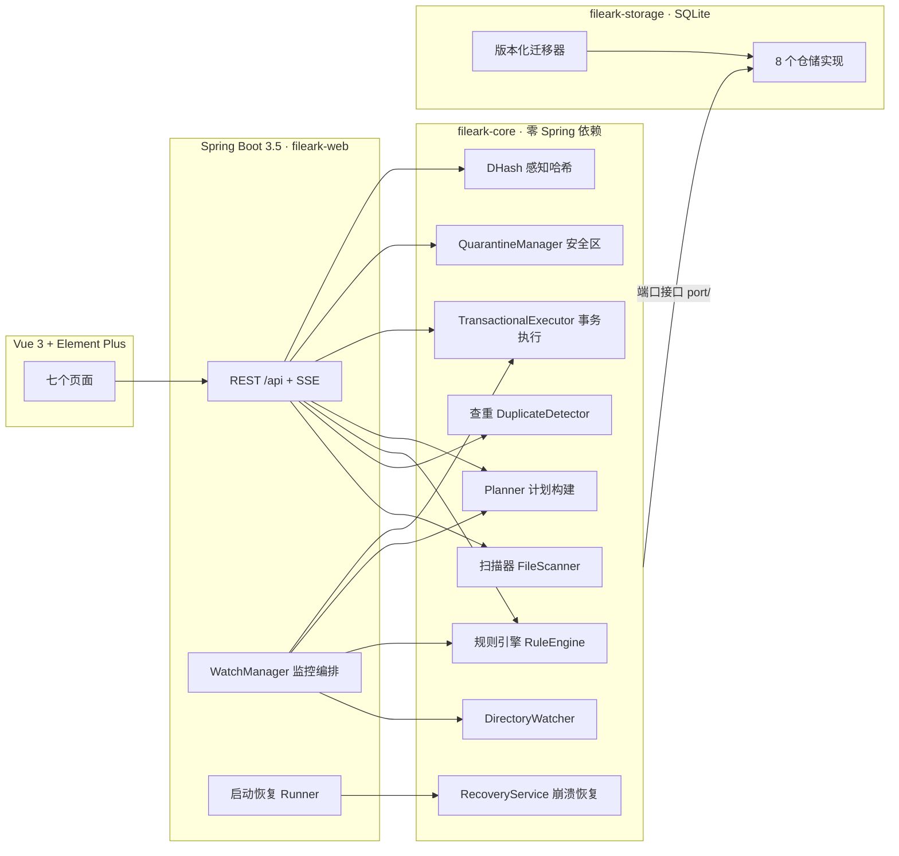
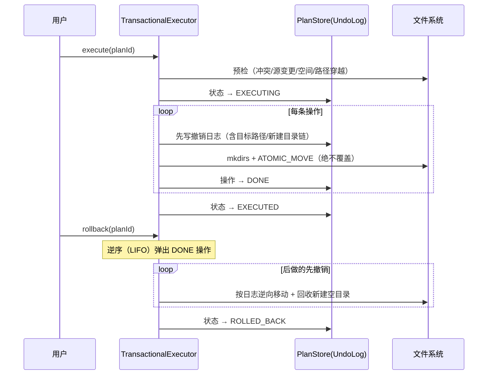

# FileArk 文件方舟

本地文件智能整理与去重引擎：扫描目录 → 两阶段指纹查重 → 规则自动归档 → **事务式执行（预检 + 撤销日志 + 崩溃恢复）** → 安全区兜底。所有危险操作可预览、可撤销、可崩溃恢复。

>
> CI：GitHub Actions 在每次 push/PR 上运行后端 `mvnw verify` 与前端构建。

## 目录

- [功能总览](#功能总览)
- [架构](#架构)
- [核心机制：文件系统上的事务](#核心机制文件系统上的事务)
- [实测性能](#实测性能)
- [快速开始](#快速开始)
- [测试](#测试)
- [桌面打包](#桌面打包)
- [工程取舍记录](#工程取舍记录)

## 功能总览

| 模块 | 能力 |
|---|---|
| 扫描查重 | 两阶段指纹（size 分桶 → 头/中/尾抽样 → 虚拟线程并行全量 SHA-256）；**增量扫描**：path+size+mtime 未变直接复用历史哈希；**一键清理全部重复组**（一个计划、一次预检执行、可整体撤销）；**CSV 报告导出** |
| 规则引擎 | 条件（类型/大小/时间/正则/路径）+ 动作（移动/重命名/标记），优先级首条命中；dry-run 与真实执行共用同一构建路径 |
| 事务执行器 | 执行前预检（冲突/**计划内目标冲突**/变更/空间/穿越）→ 变更前写撤销日志 → 失败自动逆序回滚 → 崩溃重启按日志重放；`NEEDS_REVIEW` 支持人工复核闭环（`ACKNOWLEDGED`） |
| 安全区 | 删除必经隔离目录（uuid 改名防冲突），登记元数据、30 天保留期、随时恢复、一键清除到期、二次确认彻底删除 |
| 目录监控 | WatchService 递归监听 + 500ms 防抖 + 文件稳定性检查（下载中文件不动它）→ 新文件自动按规则整理，绑定关系重启自动恢复 |
| 相似图片 | 手写 dHash（灰度 → 9×8 降采样 → 64-bit）+ 汉明距离 + 并查集传递闭包分组；前端缩略图网格页（点击放大） |
| 控制台 | 仪表盘 / 扫描查重 / 相似图片 / 规则管理 / 执行中心 / 安全区 / 目录监控 / 设置 八个页面；SSE 实时进度；`~/Downloads` 快捷目录、重新扫描、时间本地化展示 |
| 启动体验 | `scripts/start.sh` 一键启停；启动后自动打开浏览器（可关）；扫描根目录防呆（拒绝 `/` 与整个主目录）；中断的扫描启动时自动标记失败 |
| 安全默认 | 服务只监听 `127.0.0.1`（局域网不可访问）；缩略图只接受已索引档案 id；`scan.excludes` 受保护目录永不进入索引 |

## 架构



依赖方向 `web → storage → core`；core 通过 `port/` 包的 8 个接口反转存储依赖，由 ArchUnit 在测试中强制（core 不 import Spring/jakarta，storage 不 import web）。

## 核心机制：文件系统上的事务

文件系统没有事务，本项目用「预检 + 撤销日志 + 状态机 + 启动重放」自实现：



- **执行中失败**：已成功条目自动逆序回滚，计划 → `FAILED`（终态，重试 = 新建计划）；回滚未完成 → `NEEDS_REVIEW` 人工确认。
- **进程崩溃**：重启时 `RecoveryService` 找到 `EXECUTING` 计划，核对磁盘实况后按日志重放回滚；与磁盘矛盾的条目进 `NEEDS_REVIEW`。
- **删除语义**：只进安全区（uuid 改名），登记 `quarantine_item`；撤销/恢复原路返回。

## 实测性能

Apple M 系列 · JDK 21 · `-Xmx1g`。两套数字：E2E 功能基准（`scripts/e2e_bench.py`）与万级规模基准（`scripts/bench_large.py`，独立数据库隔离运行）。

| 指标 | E2E（3,000 文件 / 299MB / 299 个重复副本） | 万级基准（20,000 文件 / 251MB / 5,000 个重复） |
|---|---|---|
| 首次全量扫描 | 6.9 s | 27 s（≈740 文件/秒） |
| 计划执行（批量入安全区） | 298 副本 1.18 s | — |
| 完整撤销（逐文件还原） | 298 文件 1.25 s | — |
| 二次扫描（增量） | 哈希复用 299/299 | 25.5 s，**哈希复用 5,000/5,000（100%）** |
| 常驻内存（RSS） | ≈ 260 MB | ≈ 260 MB |
| 自动化验证 | E2E 12 项断言 + 45 个测试全绿 | 同左 |

> 性能注记：增量复用最初按文件逐条查库（每次新开 SQLite 连接），2 万文件二次扫描反而比首次慢一倍（100.7s vs 47.5s）；改为单条 SQL 全量预取 + 内存三元组匹配后降到 25.5s。为加速而生的功能，先测它真的在加速。

桌面打包（`scripts/package-desktop.sh`，jpackage）已实测：123MB 免安装 `.app`，独立运行验证通过。

## 快速开始

前置：JDK 21、Node.js ≥ 20。Maven Wrapper 已随仓库提供，无需安装 Maven。

```bash
# 1. 构建前端（产物输出到 fileark-web 静态资源目录）
cd fileark-ui && npm install && npm run build && cd ..

# 2. 后端测试 + 打包
./mvnw verify

# 3. 一键启动（自动开浏览器；重复执行会直接唤起浏览器不重复起服务）
scripts/start.sh
# 停止：scripts/stop.sh
# API 文档: /swagger-ui.html

# 前后端分离开发：后端照常启动，前端 npm run dev（Vite 代理 /api → 8080）
```

数据与安全区默认在 `~/.fileark/`（可用 `--app.db-path` / `--app.quarantine-dir` 覆盖）。

## 测试

```bash
./mvnw test          # 42 个测试：core 35 + storage 4 + 架构守护 3
```

- **属性测试**（jqwik，各 100 组随机用例）：不变量 A——任意「移动/重命名/移入安全区」操作序列执行后撤销，目录树逐字节还原；不变量 B——构建计划（dry-run 路径）绝不触碰磁盘。
- **故障注入**：第 k 条操作强制失败 → 自动逆序回滚；模拟「执行一半崩溃」→ 重启按日志恢复。
- **ArchUnit**：core 零 Spring 依赖、模块依赖方向守护。
- **E2E**：`scripts/e2e_bench.py` 对真实运行的后端做 12 项断言（扫描 → 查重 → 计划 → 执行 → 撤销 → 增量 → 监控 → 仪表盘）。

## 桌面打包

```bash
scripts/package-desktop.sh   # jpackage 生成 .app/.dmg（免装 JRE）
```

## 工程取舍记录

| 决策 | 选择 | 原因 |
|---|---|---|
| Schema 迁移 | 内置版本化迁移器（~100 行） | SQLite 属 Flyway 10+ 社区库支持，官方 artifact 不稳定 |
| 进度推送 | SSE | 单向推送足够，重连语义简单 |
| 稳定性判定 | 文件大小两次采样 | 防下载中间态误判；同大小重写不算「不稳定」是刻意边界 |
| 父 POM | 自定义（非 spring-boot-starter-parent） | 多模块统一版本管理；因此需显式开启 `-parameters` 编译参数（踩坑记录） |
